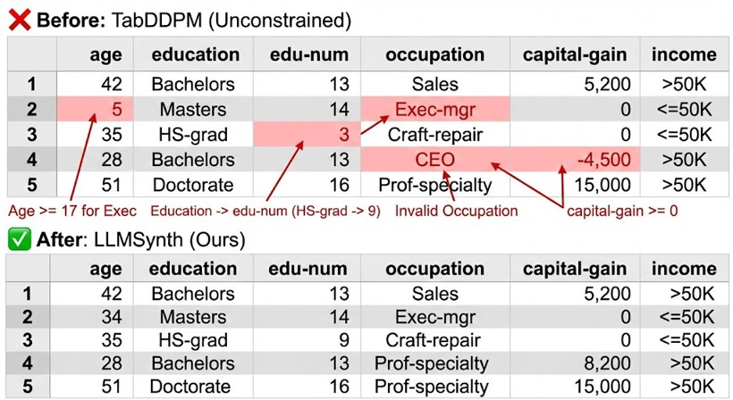
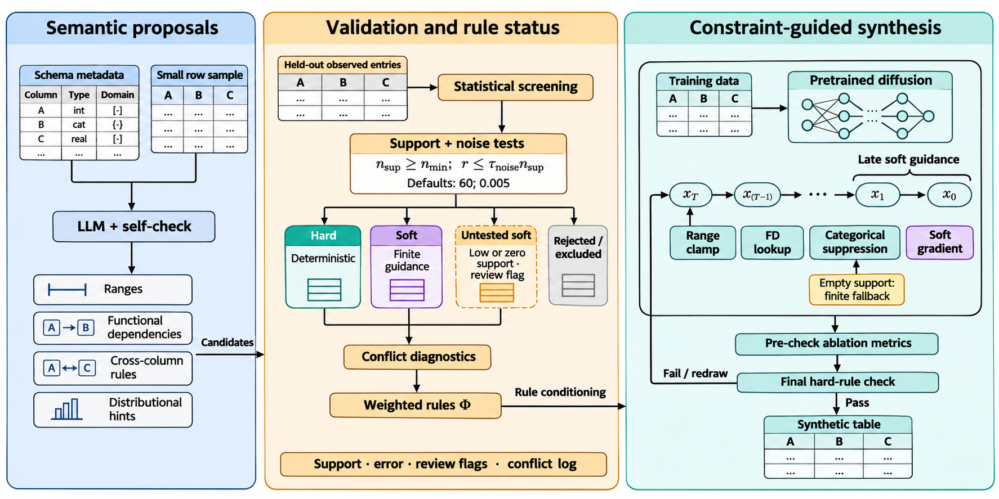

# LLMSynth

**LLM-proposed semantic constraints for tabular diffusion — hard rules stay hard, soft rules guide, untested rules stay off the sampler.**

LLMSynth mines candidate constraints from schema and sample rows with an LLM, screens them into hard / soft / untested roles, then steers a TabDDPM-style synthesizer so hard predicates survive every denoising step.

<p align="center">
  <a href="#the-picture"><strong>The picture</strong></a>
  &nbsp;·&nbsp;
  <a href="#quick-start"><strong>Quick start</strong></a>
  &nbsp;·&nbsp;
  <a href="#layout"><strong>Layout</strong></a>
  &nbsp;·&nbsp;
  <a href="#citation"><strong>Citation</strong></a>
</p>

---

## The picture

Without constraint roles, a generator can invent rows that look plausible and still break domain rules. With roles, hard predicates clamp the sample path; soft predicates pull; untested proposals never enter the guidance loop.

<p align="center">
  
</p>
<p align="center"><em>Motivation: unconstrained samples vs samples that respect screened constraints.</em></p>

<p align="center">
  
</p>
<p align="center"><em>Discovery → role screen → constrained diffusion release.</em></p>

---

## Quick start

Python 3.10+. CUDA optional (CPU works for smoke tests).

```bash
pip install -r requirements.txt
cp .env.example .env   # set ANTHROPIC_API_KEY for live LLM discovery
```

Smoke (mock discovery, no API):

```bash
python run_experiments.py --dataset adult --use-mock --seeds 1 --epochs 2
```

RelDDPM / TabDiff harness smoke (after cloning third-party baselines — see `third_party/README.md`):

```bash
python scripts/smoke_relddpm_tabdiff.py
```

Full grid options live in `run_experiments.py` (`--dataset`, `--method`, `--seeds`, `--epochs`, `--use-cache`, `--output-dir`). Outputs under `results*/` are gitignored.

---

## Layout

| Path | Role |
|------|------|
| `llm_discovery.py` | Schema + sample → candidate constraints |
| `validation.py` | Hard / soft / untested screen (support, noise tolerance) |
| `constraints.py` | Types, checking, violation rates |
| `synthesizer.py` | Training and sampling with constraint guidance |
| `datasets.py` | Public benchmark loaders (download at run time) |
| `metrics.py` | Evaluation metrics |
| `run_experiments.py` | End-to-end driver |
| `benchmark_config.py` | Dataset / method grid |
| `baselines/` | RelDDPM and TabDiff adapters |
| `scripts/` | Smoke helpers; optional GCP wrappers |
| `tests/` | Unit tests for the validation screen |
| `third_party/` | Clone RelDDPM / TabDiff here (not vendored) |
| `docs/figures/` | README plates |

Benchmarks download via scikit-learn / OpenML. Eight manuscript datasets: `adult`, `credit`, `heart`, `diabetes`, `wine`, `bank`, `default`, `california_housing`.

---

## Citation

If you use this code or the method, please cite:

```bibtex
@article{kang2026llmsynth,
  title   = {Making Synthetic Tables Semantically Valid via {LLM} Constraints},
  author  = {Kang, Nathaniel},
  journal = {Information Systems},
  year    = {2026},
  note    = {To appear}
}
```

Update volume, pages, and DOI when Elsevier posts them.

## License

Research code provided as-is for reproducibility; see repository license if present.
